<!-- Template file for README.md for LEIC-ES-2025-26 -->

# _UrbanEye_ Development Report

Welcome to the documentation of _UrbanEye_!

This Software Development Report, tailored for LEIC-ES-2025-26, provides comprehensive details about _UrbanEye_, starting from an high-level vision and going into low-level implementation decisions. 

It is organised by the following activities: 

* [Business modeling](#Business-Modelling) 
  * [Product Vision](#Product-Vision)
  * [Features and Assumptions](#Features-and-Assumptions)
* [Requirements](#Requirements)
  * [User stories](#User-stories)
  * [Domain model](#Domain-model)
  * [User interfaces](#User-interfaces)
* [Architecture and Design](#Architecture-And-Design)
  * [Logical architecture](#Logical-Architecture)
  * [Physical architecture](#Physical-Architecture)
  * [Functional prototype](#Functional-Prototype)
* [Project management](#Project-Management)
  * [Sprint 0](#Sprint-0)
  * [Sprint 1](#Sprint-1)
  * [Sprint 2](#Sprint-2)
  * [Sprint 3](#Sprint-3)
  * [Final Release](#Final-Release)
  * [Usage of AI] (#Usage-of-ai-in-the-project)

Contributions are expected to be made exclusively by the initial team, but we may open them to the community, after the course, in all areas and topics: requirements, technologies, development, experimentation, testing, etc.

Please contact us!

Thank you!

* Ana Baldaque - up202405858@up.pt
* Guilherme Dias - up202403340@up.pt
* Maria Luísa Ferreira - up202406040@up.pt
* Nuno Gonçalves - up202403355@up.pt
* Raquel Silva - up202404971@up.pt

---

## Business Modelling

Business modeling in software development involves defining the product's vision, understanding market needs, aligning features with user expectations, and setting the groundwork for strategic planning and execution.

### Product Vision

#### Project Overview & Vision

The UrbanEye Application  application aims to bridge the gap between civic engagement and urban maintenance by providing a real-time platform where citizens can report local infrastructure issues, such as waste accumulation, malfunctioning streetlights, floods, or illegal dumping. By leveraging crowdsourced data, the application provides a centralised map interface that visualises the geographical distribution of urban incidents.

The ultimate goal is to empower city councils and local authorities to transition toward a **Smart City model**, enabling them to make more sustainable and resource-efficient decisions. By analysing report density and patterns, authorities can reduce urban waste of resources, such as:

- **Logistical inefficiencies:** Optimising collection routes based on actual demand rather than fixed schedules.

- **Response lag:** Identifying critical infrastructure failures (like floods or lighting) before they escalate into costly public safety hazards.

- **Budget misallocation:** Prioritizing interventions in high-incident areas based on real-time data rather than anecdotal evidence.

#### Core Value Proposition

The platform transforms the passive role of a resident into an active **"city sensor"**. This synergy between citizens and government not only speeds up the resolution of urban problems but also fosters a sense of shared responsibility for the environment. Through the integration of geolocation and media uploads (photos/videos), the platform ensures that every report is actionable, verifiable, and transparent, leading to a cleaner, safer, and more resilient urban landscape.

#### Strategic Alignment with SDGs:

The project supports the UN 2030 Agenda by improving urban management and citizen participation. It contributes to SDG 11 through better urban sustainability and waste collection, SDG 12 by helping authorities reduce waste with better data, and SDG 16 by promoting transparency and stronger communication between citizens and government.

### Features and Assumptions

#### Features:

**User Management:** Secure Registration, Authentication, and Password Recovery.

**Interactive Geolocation:** Automatic GPS positioning with manual map override.

**Multimedia Reporting:** Photo uploads and descriptive metadata for incident verification.

**Authority Dashboard:** Tools for status updates, incident filtering, and priority management.

**Crowdsourced Validation:** Ability for other users to "Confirm" or "Deny" the existence of a reported problem (improving data reliability).

**Real-time Alerts:** Push notifications for status updates and nearby incident alerts.

#### Assumptions:

**Connectivity:** Internet connection is required to submit the report and load map tiles. However, the application should be able to capture GPS coordinates offline, caching the report data locally until a network connection is restored.

**Hardware:** User devices must be equipped with a GPS module and optionally a Camera.

**Third-Party Services:** Reliable integration with a Map API (e.g., Google Maps).

**Institutional Setup:** Local authorities have designated administrative accounts with appropriate permission levels.

## Requirements

### User Stories

1. As a user, I want to report problems so that the authorities know about them.
    
2. As a user, I want to mark the location of a problem on the map so that I can indicate exactly where it is.
    
3. As a registered user, I want to confirm whether a problem exists or indicate that it does not exist, so that the credibility of the reports is ensured.
    
4. As a registered user, I want that whenever I report a problem I am able to include a photo so that the problem is clear.
    
5. As a not registered user, I want to create a new account on the app so that I can access features that require registration.
    
6. As a registered user, I want to log into the app so I can access my reports and the map.
    
7. As an authority, I want to update the status of a problem, so users are informed.
    
8. As an authority, I want multiple reports of the same problem to be grouped into a single alert so that I can see how many users reported it and prioritise the issue.
    
9. As a user, I want to get more information on a reported problem.
    
10. As a registered user, I want to consult my previous reports.

#### Most important Story Details:

*As a* user,

*I want to* report problems

*so that* the authorities know about them.

##### Business Value:

Enables rapid response to urban hazards by crowdsourcing incident detection. This allows authorities to stop environmental damage and budget-draining repairs before they escalate, while significantly increasing civic engagement by giving citizens a direct role in improving their community.

Assumptions/Dependencies: It is assumed that citizens have access to GPS-enabled mobile devices and are willing to grant the app permission to access their location and optionally their camera.

The dependencies include integration with a map service (such as Google Maps) to convert coordinates into addresses, as well as a back-end server configured to receive and store image files and associated metadata.

##### Scenarios:

**Normal case:**

- A user detects a problem and has an active internet connection (GPS and network are functional). 
The user shares their location. 
The user selects the "Problem Type" from a list or types a custom description under "Others". 
The user provides a brief description and optionally uploads a photo.

  - The system must successfully convert coordinates into an address and store the metadata.
  - The user must receive a "Successo!" confirmation message

 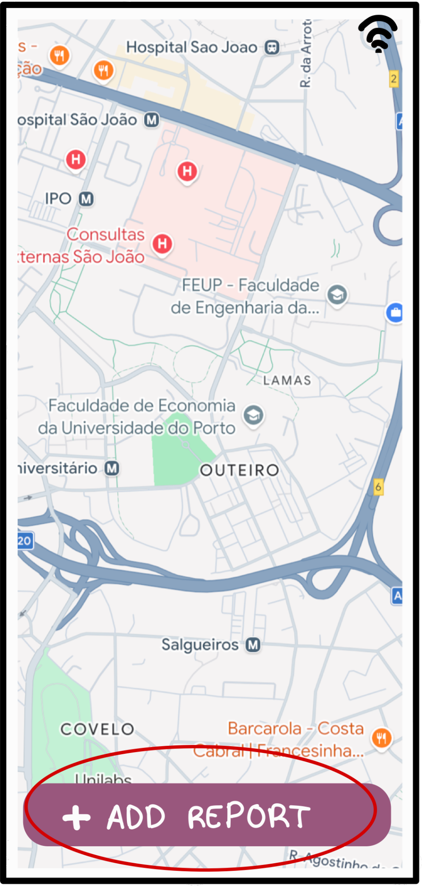
 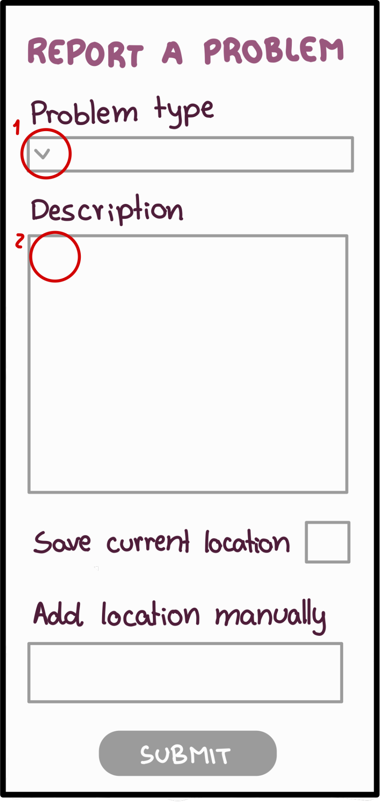
 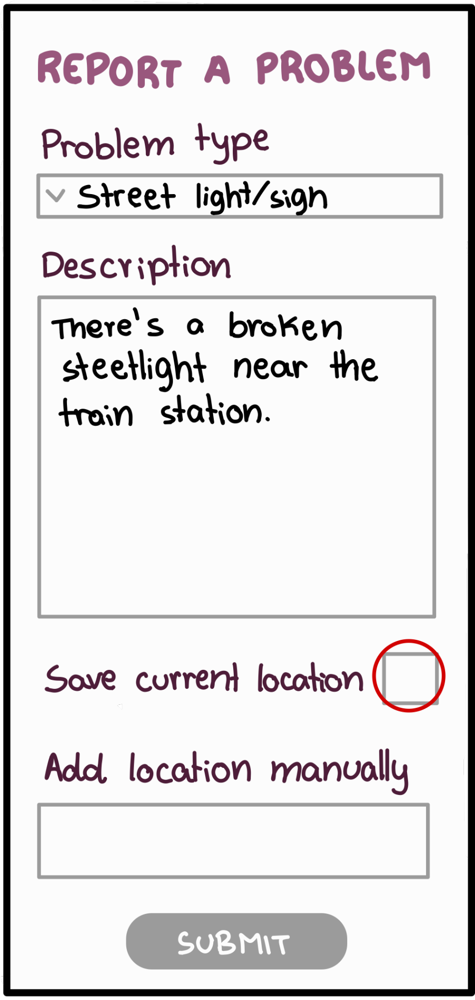

 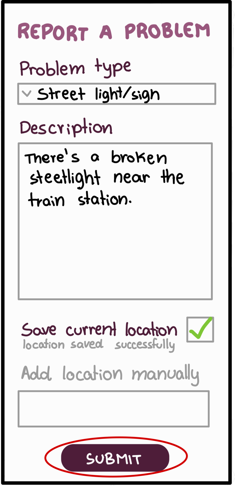
 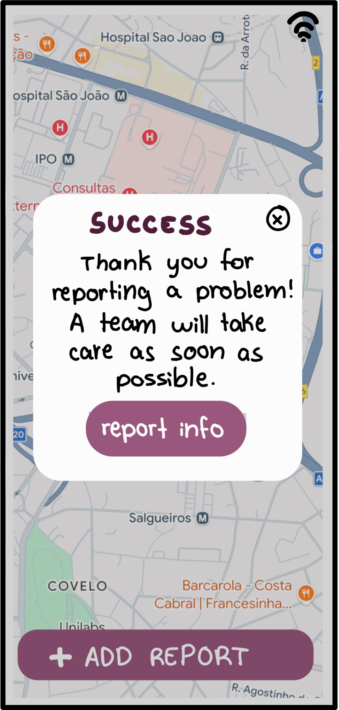

 

**Exceptional case:**

- A user detects a problem but there is no network coverage at the location.
User attempts to report the incident.
User selects "SIM” to the "Guardar Localização?" prompt.
User moves to an area with network coverage.

  - The system must successfully capture and cache GPS coordinates while offline.

  - The report must be automatically processed/synchronized once network is restored (the steps 2/3/4 of the normal case mockup must then appear)

 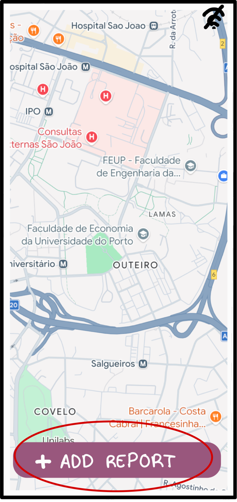
 
 

 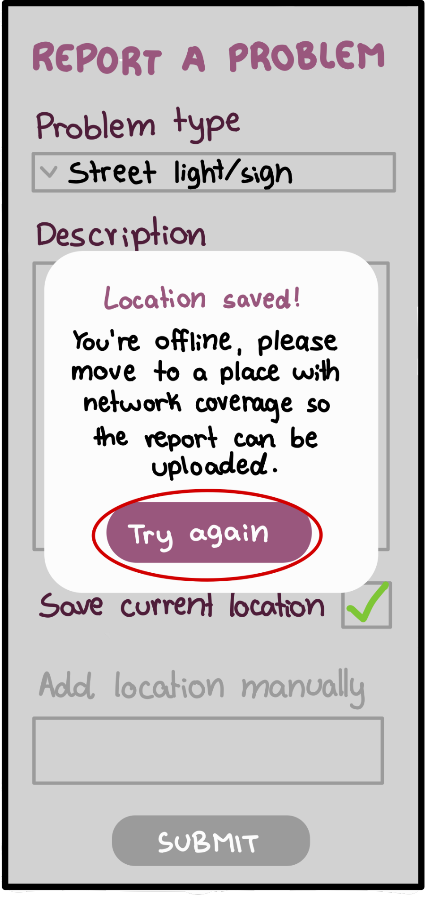
 
 

### Domain model
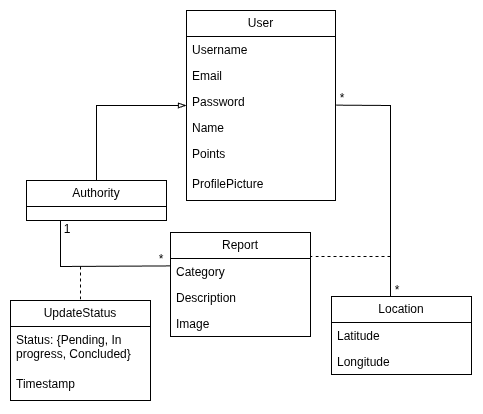

## Architecture and Design
<!--
The architecture of a software system encompasses the set of key decisions about its organization. 

A well written architecture document is brief and reduces the amount of time it takes new programmers to a project to understand the code to feel able to make modifications and enhancements.

To document the architecture requires describing the decomposition of the system in their parts (high-level components) and the key behaviors and collaborations between them. 

In this section you should start by briefly describing the components of the project and their interrelations. You should describe how you solved typical problems you may have encountered, pointing to well-known architectural and design patterns, if applicable.
-->

### Logical architecture
<!--
The purpose of this subsection is to document the high-level logical structure of the code (Logical View), using a UML diagram with logical packages, without the worry of allocating to components, processes or machines.

It can be beneficial to present the system in a horizontal decomposition, defining layers and implementation concepts, such as the user interface, business logic and concepts.

Example of _UML package diagram_ showing a _logical view_ of the Eletronic Ticketing System (to be accompanied by a short description of each package):

-->
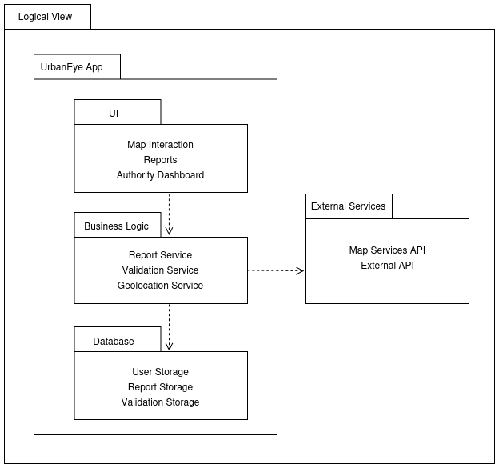

### Physical architecture
<!--
The goal of this subsection is to document the high-level physical structure of the software system (machines, connections, software components installed, and their dependencies) using UML deployment diagrams (Deployment View) or component diagrams (Implementation View), separate or integrated, showing the physical structure of the system.

It should describe also the technologies considered and justify the selections made. Examples of technologies relevant for ESOF are, for example, frameworks for mobile applications (such as Flutter).

Example of _UML deployment diagram_ showing a _deployment view_ of the Eletronic Ticketing System (please notice that, instead of software components, one should represent their physical/executable manifestations for deployment, called artifacts in UML; the diagram should be accompanied by a short description of each node and artifact):

-->
The UrbanEye mobile application runs in the operating system environment of the user's mobile device. The UI allows users to interact with the platform, such as submitting incident reports and browsing reported issues. The application logic handles each of these actions accordingly. Persistent data, including user profiles and incident reports, is stored and managed through Firebase, while map tiles are retrieved from an external tile server.

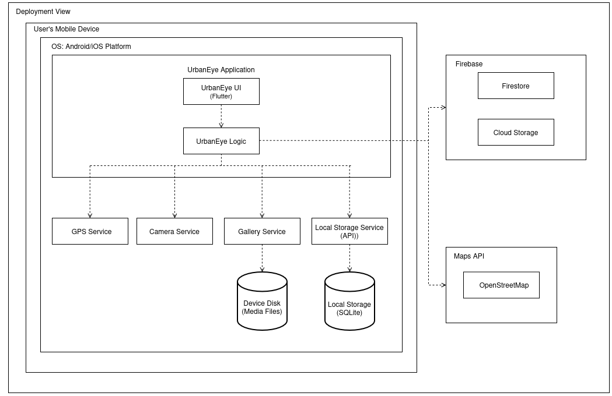

### Functional prototype
<!--
To help on validating all the architectural, design and technological decisions made, we usually implement a functional prototype, a thin vertical slice of the system integrating as much technologies as we can.

In this subsection please describe which feature, or part of it, you have implemented, and how, together with a snapshot of the user interface, if applicable.

At this phase, instead of a complete user story, you can simply implement a small part of a feature that demonstrates thay you can use the technology, for example, show a screen with the app credits (name and authors).
-->

## Project management
<!--
Software project management is the art and science of planning and leading software projects, in which they are planned, implemented, monitored and controlled.

In the context of ESOF, we recommend each team to adopt a set of project management practices and tools capable of registering tasks, assigning tasks to team members, adding estimations to tasks, monitor tasks progress, and therefore being able to track their projects.

Common practices of managing agile software development with Scrum are: backlog management, release management, estimation, Sprint planning, Sprint development, acceptance tests, and Sprint retrospectives.

You can find below information and references related with the project management: 

* Backlog management: Product backlog and Sprint backlog in a [Github Projects board](https://github.com/orgs/FEUP-LEIC-ES-2023-24/projects/64);
* Release management: [v0](#), v1, v2, v3, ...;
* Sprint planning and retrospectives: 
  * plans: screenshots of Github Projects board at begin and end of each Sprint;
  * retrospectives: meeting notes in a document in the repository, addressing the following questions:
    * Did well: things we did well and should continue;
    * Do differently: things we should do differently and how;
    * Puzzles: things we don’t know yet if they are right or wrong;
    * list of a few improvements to implement next Sprint;

-->

### Sprint 0

### Sprint 1
Initial GitHub Project screenshot:
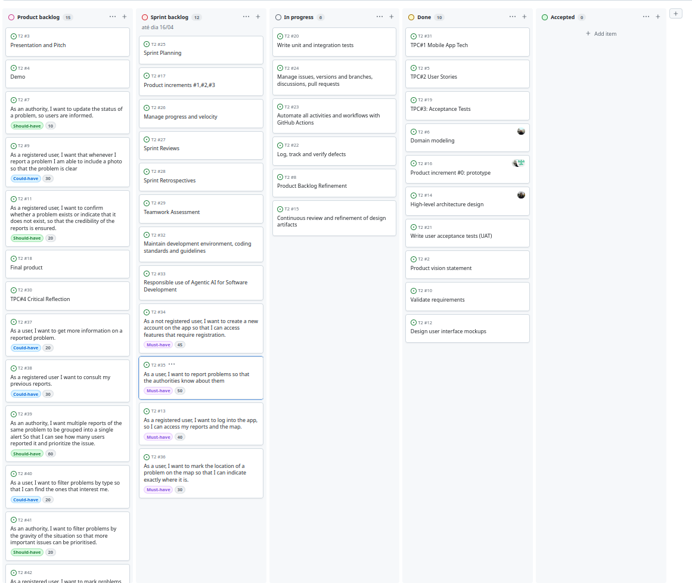

Review:

During Sprint 1, we achieved the functionalities planned for this sprint. The system now supports reporting urban issues, such as power failures and water leaks, through a user-friendly interface.

Retrospectives:

One important design decision made during this sprint was the revision of user roles. Initially, the system differentiated strictly between "clients" and "authorities", with only clients being able to report issues. However, we recognized the need for greater flexibility and updated the authority role to also include client functionalities, namely the ability to report problems. This adjustment enhances the overall usability and practicality of the application.

Final GitHub Project screenshot:
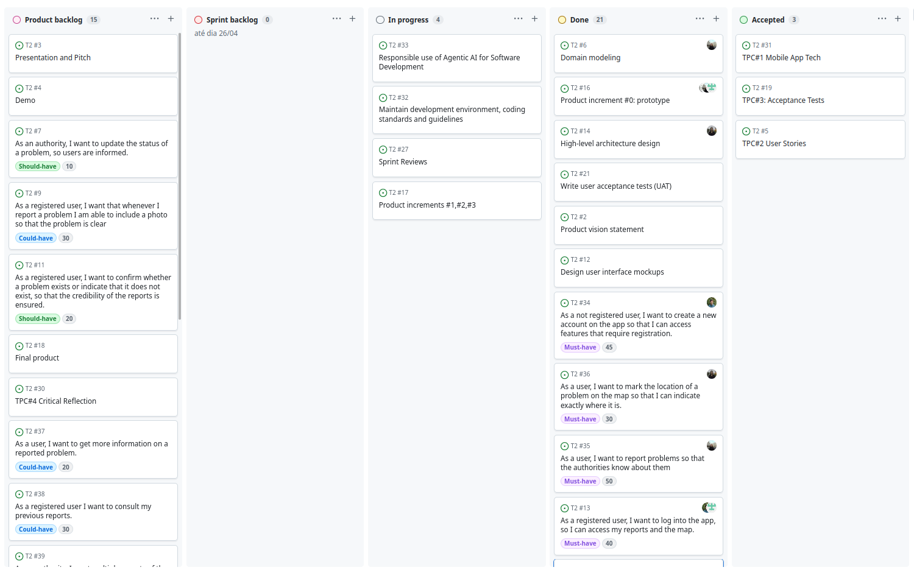

### Sprint 2
Initial GitHub Project screenshot:
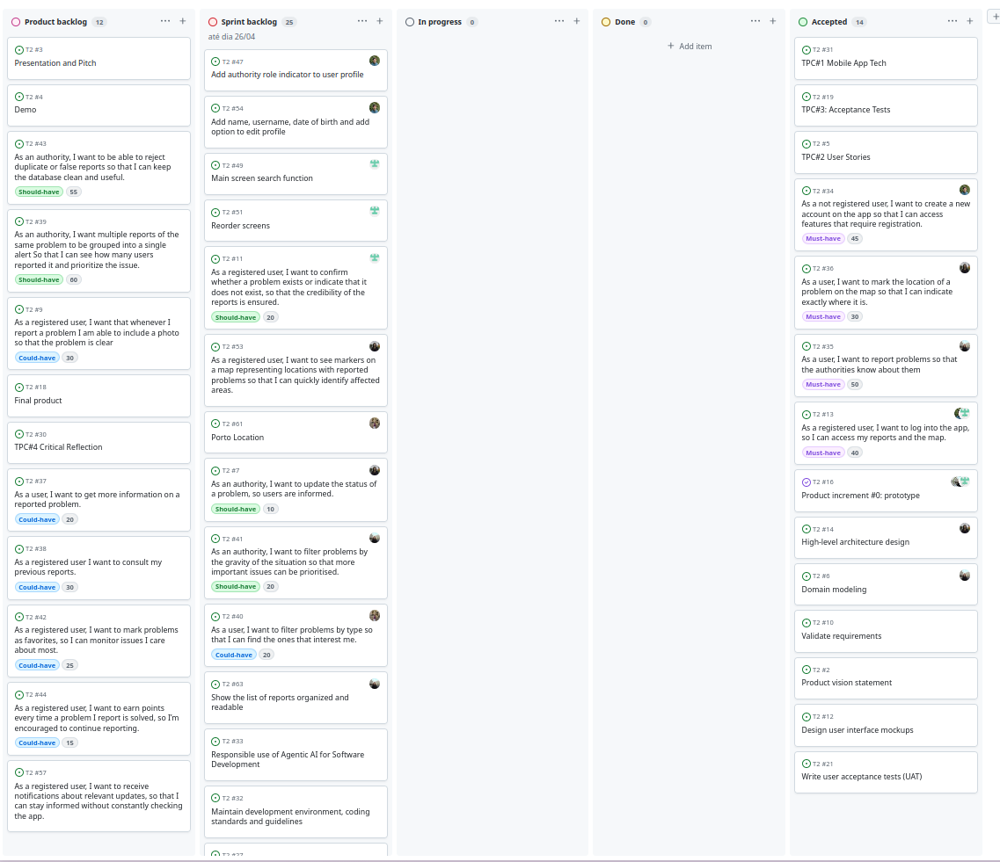

Review:

During Sprint 2, we achieved the functionalities planned for this sprint, significantly expanding the application’s core features. We enhanced the user profile system by adding authority role indicators and enabling the editing of personal data such as name, username, and date of birth. On the interface side, we implemented a main screen search function and reordered navigation for better flow. A key adjustment was made to the map component: we corrected the default geographical focus so that it now correctly initializes at the Porto location rather than Lisbon, ensuring the tool is immediately relevant to our target area. Furthermore, we finalized filtering systems that allow authorities to prioritize issues by gravity and users to sort problems by type.

Retrospectives:

The team conducted a formal review of our progress and registered the findings in our GitHub repository. This process allowed us to analyze our development velocity and the integration of new features within the existing framework. We focused on how the team transitioned from basic reporting to more complex data management, ensuring that the new visualization and filtering tools remain intuitive for both regular users and authorities as the project grows in complexity.

Strategy for Improvement:

Regarding areas for improvement, we recognized that some tasks suffered from initial ambiguity, specifically concerning UI reordering, which led to minor coordination delays. To address this, we have established a strategy with verifiable action points for the next sprint. First, we will ensure that every backlog item includes detailed acceptance criteria before the sprint starts to eliminate guesswork. Second, we will continue our established practice of requiring documented proof of testing for every Pull Request to maintain consistency. Finally, we will mandate that technical documentation is updated immediately upon the completion of each feature to ensure project clarity is maintained throughout the development process. 

Final GitHub Project screenshot:
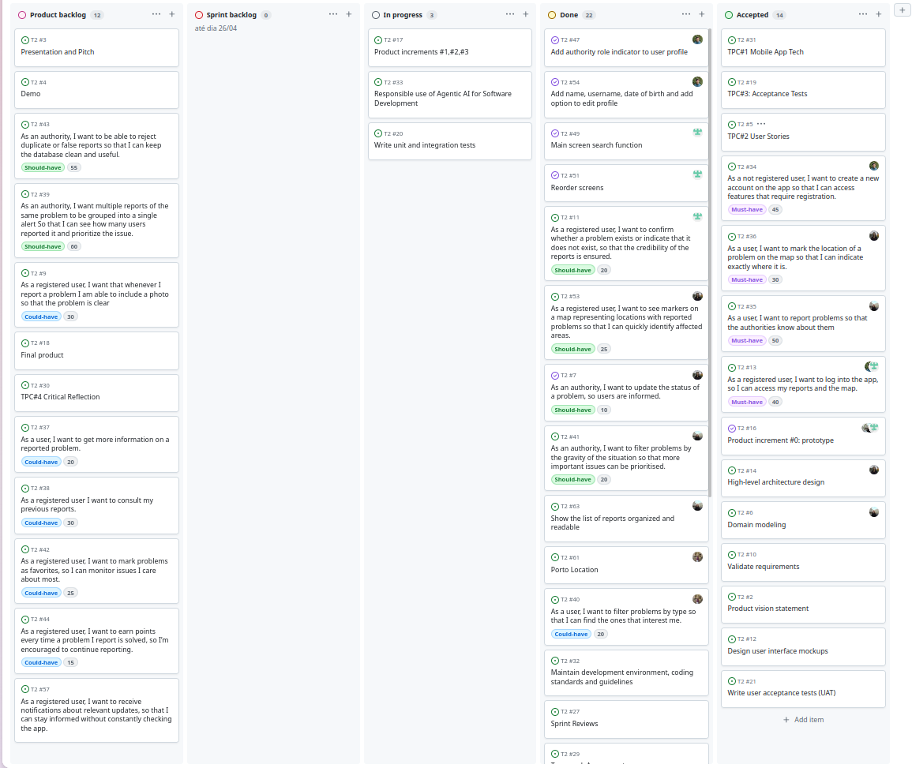

### Sprint 3
Initial GitHub Project screenshot:
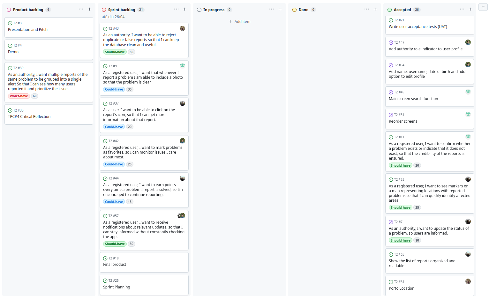

### Final Release

### Usage of AI in the Project
The development of this project was conducted with the frequent integration of artificial intelligence tools, which played a central role throughout the software engineering process. Tools such as Claude (Anthropic), Gemini (Google) and ChatGPT (OpenAI) were consistently employed across multiple stages of development, from initial design decisions to the implementation of specific features.
The majority of the codebase was produced with direct AI assistance, encompassing the development of core application features, backend services, and automated tests. This included the implementation of report submission and confirmation workflows, user authentication logic, geolocation-based filtering, and the notification mechanisms through which relevant authorities are alerted to validated occurrences. AI tools proved particularly valuable in accelerating the development of repetitive but critical components, such as data validation layers, database interaction patterns, and API endpoint structuring.
Beyond code generation, these tools were also used as a means of conceptual clarification and architectural guidance. When facing design decisions — such as how to model the confirmation system, how to rank or prioritise reported issues based on community validation, or how to structure the authority-facing interface for efficient problem identification — AI assistants provided a responsive sounding board that helped the team evaluate trade-offs before committing to an implementation.
It is worth noting that AI-generated output was not adopted uncritically. All produced code, logic, and suggestions were reviewed, tested, and adjusted by the development team to ensure correctness, compliance with project requirements, and overall coherence with the intended user experience. The role of AI was therefore that of an accelerator and collaborator, rather than a replacement for informed engineering judgment.
